# FW Paint

Open source (MIT) — [github.com/nullabork/fw-paint-fabric](https://github.com/nullabork/fw-paint-fabric)

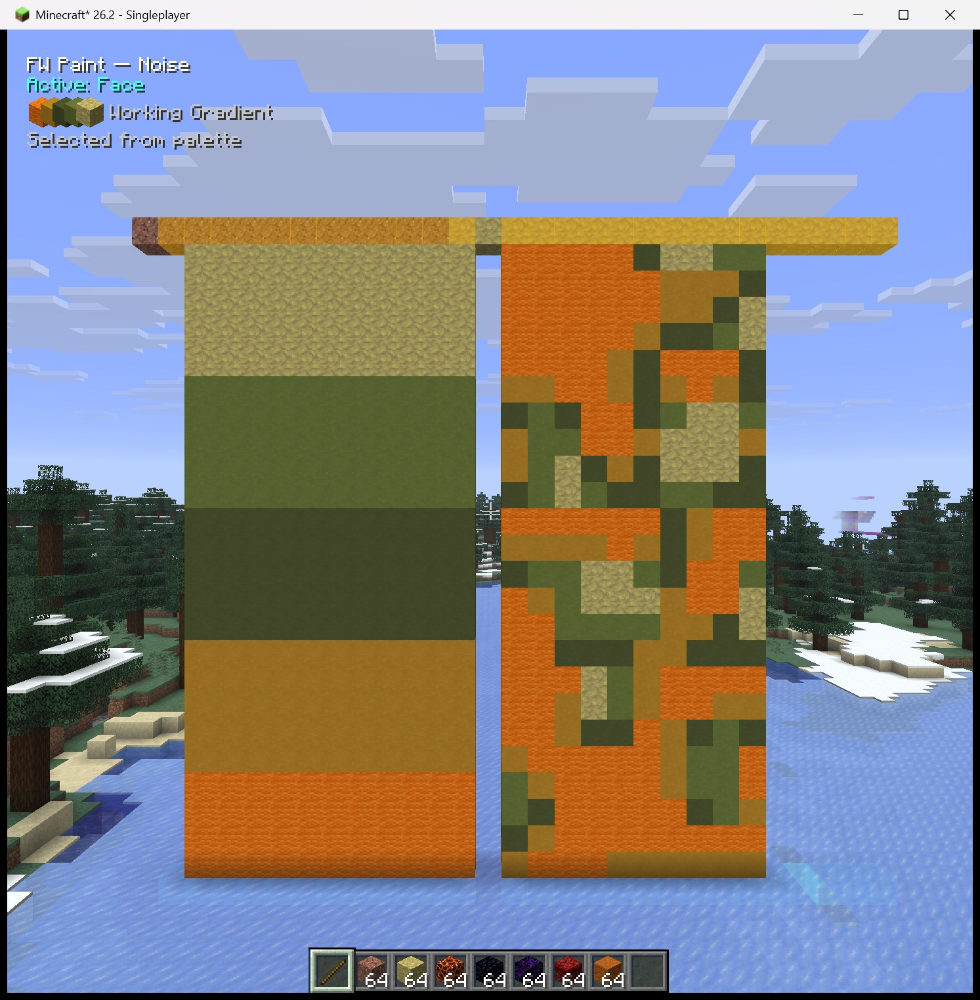

**Paint with blocks.** A client-side mod (Fabric **and** NeoForge) with four paints — **Solid**
(one block: walls, columns, volumes), **Gradient** (smooth colour/brightness blends), **Noise**
(natural, blotchy 3D patterns), and **Pattern** (hand-drawn 2D block grids painted as planes) —
driven by **Palettes** and **Patterns**: named, saved block ramps and drawings you build once and
reuse everywhere. A **Finder** tab ranks every block in the game by colour. Any paint works
through any placement mode, with or without markers and shapes. Fluids count as empty space —
paint under water or lava exactly as in air. Placement is the legit, multiplayer-safe way
(normal block-place interactions the server validates), so it works on servers.

> **v2.** Palettes replace v1's per-tool block picker. v1 gradient settings are not
> migrated — build your first palette on the Paint tab and you're going again in a minute.

## OK, but how do I actually use this?

Two ideas run the whole mod. **One**: nothing happens unless you're holding your chosen paint
tool item (a stick is traditional), so your hands stay safe for normal play. **Two**:
everything you'd ever switch lives on one wheel — hold **G**, hover a wedge to fan it out,
click an option, release. WHAT you paint (**Paint**: Solid / Gradient / Noise / Pattern) and
WHERE blocks go (**Place**: Blocks / Markers / Shapes) are two independent choices, and the HUD
in the top-left always shows both.

The 60-second version:

1. Press **K** → **Settings** → click any item in the **Paint tool** list.
2. Hold that item. Hold **G** → hover **Paint** → click **Solid**.
3. Still on the wheel: hover **Palette** → **This block** → click a block from your inventory.
4. Release G, aim at any block face, **right-click**. You're painting — hold to keep going.

From there it deepens as far as you like: palettes blend gradients and noise along your build,
patterns paint hand-drawn grids, and markers + shapes (boxes, rings, lines) aim and bound
everything — a giant gradient cylinder is a two-minute job. Every section of the screen has a
**?** that opens the matching page of the in-game **Help** tab, a drill-down manual for every
piece.

### Every input

| Input | Does |
| --- | --- |
| **K** | Open / close the FW Paint screen (Paint, Place, Finder, Settings, Help) |
| **G** (hold) | The wheel: Paint · Palette · Place — everything |
| **B** | Next palette, pattern or block (whichever the paint type uses) |
| **L-Ctrl** | Modifier: the other way · both ends · all nodes (with MMB: delete connected) |
| **Alt** (hold) | Lock a marker drag to an axis |
| **Right-click** | Paint (hold to keep going); end markers in marker modes; a control's quick action; cancels a half-made shape |
| **Left-click** | Start markers and shape points; drag controls; open a shape's cog toolbar |
| **Middle-click** | Delete the smallest marker piece you aim at — Ctrl+MMB deletes the whole line or marker group |
| **Scroll** (on a shape) | Push / pull it along its axis — Ctrl+scroll grows / shrinks it |

Keys are rebindable under Options → Controls → Key Binds → **FW Paint**; the Settings tab's
**Keys & gestures** list always shows the live bindings.

## The screen

**K** opens the screen and closes it again. Five tabs: **Paint** (what gets placed: paint type,
palettes, patterns, Solid's block), **Place** (the mode and its options, plus marker settings),
**Finder**, **Settings**, **Help**. Every section has one **?** — hover for a summary, click to
open that Help topic. Messages on the action bar always say where to go: "FW Paint · Area: what
happened — K › Tab".

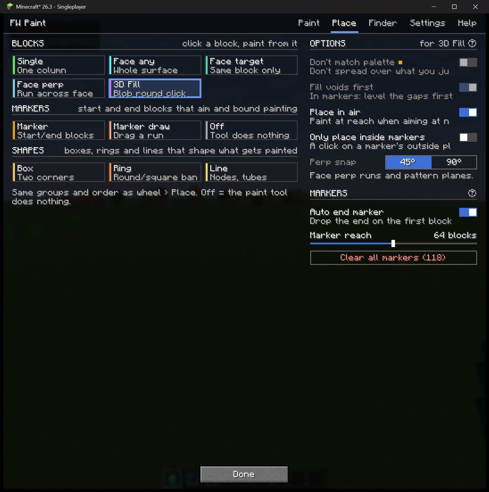

## The wheel

Hover a wedge to fan out its options; click only to choose. **Paint** fans the paint types
(Solid / Gradient / Noise / Pattern); **Palette** follows the paint type (your palettes, your
patterns, or — with Solid paint — the match modes, with **This block** fanning your inventory's
blocks in colour order); **Place** fans **Blocks** (Single / Face any / Face target / Face perp /
3D Fill), **Markers** (Marker / Marker draw), **Shapes** (Box / Ring / Line), **Options** (Don't
match palette, Fill voids first, Place in air, Perp snap 45°/90°) and **Off**. Lit means on;
grey means it doesn't apply to the current mode. Every ring ends in **More… (K)**, which opens
the screen on that tab. The wedge holding the current selection shows a blue tint; anything that
doesn't fit scrolls as a carousel (arrows or mouse wheel). Hover anything for a one-line
description along the bottom of the screen. Set several things in one hold, then release.

**Recent**, along the bottom, keeps your last picks (newest first, saved between sessions).
Click one to set it again — it switches whatever it needs, so a Solid block picked while you
paint Gradient takes you back to Solid.

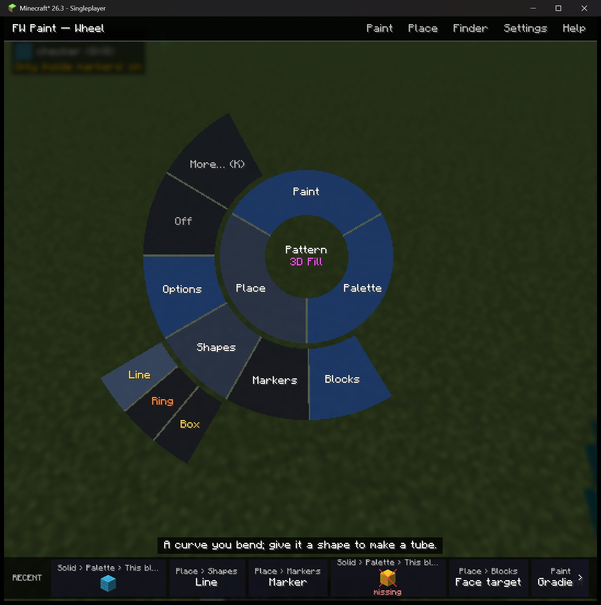

## The HUD

Line one says **Paint · Mode**; line two shows the palette strip, pattern or block. Yellow lines
appear only for options that apply and aren't at their default (● Don't match palette, Fill voids
first: off, Place in air: off, Perp snap 90°). No tool or nothing picked yet? The HUD says so
and where to fix it (K › Settings, K › Paint). With a line marker in view it also shows the
line's length and node count. **B** steps to the next palette (Gradient/Noise),
pattern (Pattern) or block (Solid).

## Palettes

One palette drives **both gradient and noise painting**. On the **Paint** tab, the **Paint
with** switch (Solid / Gradient / Noise / Pattern) picks the paint type; under Gradient or Noise
the list shows your palettes, with **+ New palette** on top. A blue outline is the selected row,
green **● in use** is what paints now, and red **N missing** counts blocks that aren't in your
inventory (by default painting refuses then; Settings → **When blocks are missing** → Skip them
paints around them). Double-click a row to use it; **Use / Edit / Duplicate / Delete** sit
beside a gradient preview, a draggable noise preview and a full summary.

**The editor** has its own top bar (‹ Paint, name, Cancel, Save — a yellow **● unsaved changes**
while you work; Save puts the palette in use) and columns in working order:

- **1 Pick blocks** — your colour-sorted blocks (Hotbar / Inventory / Both), with **Auto colour**
  and **Auto brightness** pinned at the top. **Double-click or drag** them onto the strip;
  right-click a block to ban it from Auto picks.
- **2 Arrange** — the **segment strip**, START at the top to END at the bottom. Drag the handles
  to resize segments — placement uses exactly the shares you drew (the Curve turns Custom); drag
  a segment to move it, sideways out to remove it, or click it and use ↑ ↓ / Del.
- **3 How it blends** — **Order** (Colour ↑ / Colour ↓ / Bright ↑ / Bright ↓, or Custom when
  arranged by hand), **Curve** (Linear / Ease in / Ease out / In/out / Step), **Sizing** (Min
  blocks — shortest run that fits the ratios; Fill space — out to the end marker / first block;
  Set steps — fixed length), **Variation** (Off / ±1–±3 colour-neighbour window + a swap chance —
  cells shimmer to nearby colours from your inventory), **Chaos** (how ragged the bands are) and
  **Step length** (the wobble) — plus a foldable **Noise** section (Smooth / Perlin / Fractal,
  Lock XYZ scale, Seed with a Random button), used only by Noise paint.
- **Preview** — one preview, **As gradient | As noise**; ⛶ enlarges it, drag the noise cube to
  move through the noise, and a yellow warning flags Auto segments that touch.
- **Auto segments** — the crosshatched wildcards: *Auto colour* and *Auto brightness* resolve to
  a real inventory block **when you paint**, deterministically: at the strip's start they read
  the block you started on; at the end they scan to an end marker or the first solid block — and
  if there's nothing to find, they pick the *opposite* of your start (lightest↔darkest for
  brightness, the furthest colour for colour) so you still get a full ramp. A strip of nothing
  but Autos is a reusable "gradient from whatever I'm standing on".
- One **?** per section explains it.

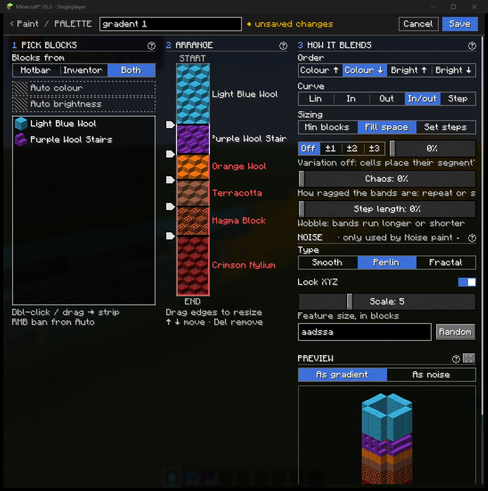

## Patterns

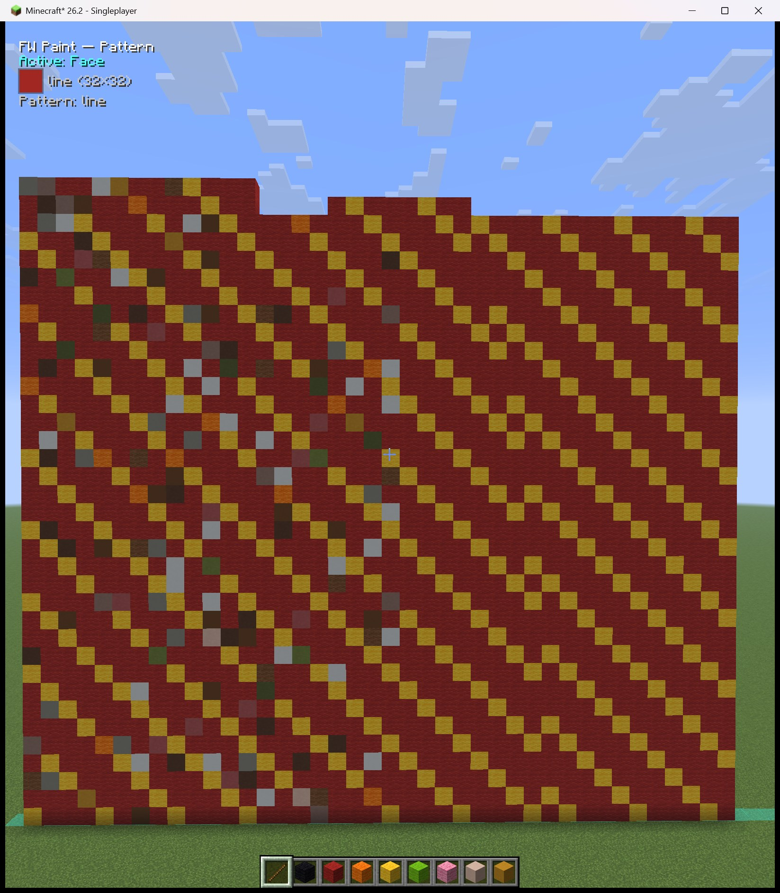

Draw a block grid by hand (up to **32×32**) and paint it as a plane. Pick **Pattern** under
Paint with, then **+ New pattern**. The editor runs **Ink · Canvas · Preview**: pick your ink
(an Eraser is pinned at the top), then choose what plain left-click does — **Draw** (a drag that
starts on your ink erases it), **Line** (straight/45°), **Fill**, **Pick** (eyedrop) or
**Origin** (where placement starts; empty cells are holes). The shortcuts work from any tool:
**Shift-drag** line, **right-click** fill, **middle-click** pick, **Ctrl-click** origin.
**How it repeats**: Tile None / Sides / Start–end / Both, **Start from Top/Bottom** (keeps
ground-up painting upright), and Variation; the preview shows the wall, variance included.
Painting advances out of the clicked face, the width crossing a plane snapped from your facing
(45°/90°) — adjacent strokes **continue the drawing** instead of restarting, so you can build a
patterned wall column by column. **B** steps through your patterns while Pattern is the paint.

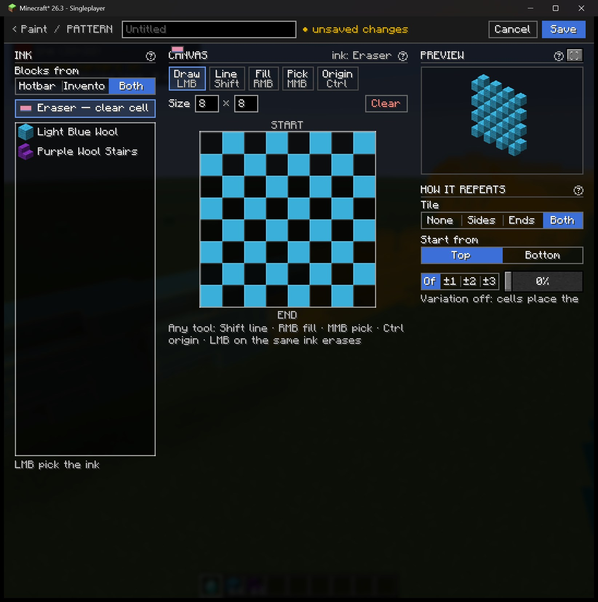

## Placement modes

Where blocks go, shared by all four paints. Pick them on the **Place** tab or the wheel. The
**green face tint + arrow** previews every face the next click grows from, and rides the
advancing fronts while you hold.

- **Single** — one column out of the clicked face; re-clicking continues from its first air gap.
- **Face any** — the whole connected plane extrudes together: click a wall's top to raise it, its
  side to thicken it. A start marker behind the clicked column selects the connected marker group
  instead.
- **Face target** — like Face any, but only blocks of the clicked block's type are selected and
  grow (click a stone floor: the stone extrudes, the grass beside it doesn't).
- **Face perp** — a 1-block-wide run through the clicked block crossing your view (perpendicular
  to your look), snapped to 45° or 90° — diagonal stair-stepped lines included. Inside markers
  only the marked blocks along the run are selected.
- **3D Fill** — a connected blob centred on the clicked block; tap for the first shell, hold to
  grow. Contained by walls, end markers, and start-marker space.
- **Off** — the tool does nothing; clicks work as normal.
- Everywhere: an **end marker stops a column or fill even floating in air**, and a finished column
  never resumes past it.
- Plants you could place into (hanging roots, grass, vines) count as solid and are left alone.

**Options** for the selected mode sit beside the modes (and on the wheel's Place › Options),
greyed when they don't apply:

- **Don't match palette** (Face any / target / perp; off again after a relaunch — the yellow
  dot) — the selection won't spread onto blocks of your palette, pattern or Solid block: lay a
  layer, click beside it, and the selection stops at the layer.
- **Fill voids first** (Face any / target, in markers) — levels the lowest columns before
  stacking new layers.
- **Place in air** (every placing mode, on by default) — blocks with nothing next to them go
  straight into the air, no scaffolding needed (aim at the sky to drop one block at reach); turn
  it off for servers whose anti-cheat flags that.
- **Only place inside markers** (every placing mode, off by default) — a click on the outside of
  a box, ring, tube or start-to-end run places nothing, so a slip can't spread a blob over the
  outside. Clicks away from markers paint as normal; the HUD shows a yellow reminder.
- **Perp snap 45° | 90°** — Face perp runs and pattern planes.

## Markers

Turquoise **starts** and amber **ends** aim and bound every tool. They aren't real blocks: block
markers reach to the **Marker reach** setting and shapes place and edit at sight range — far
beyond block reach. Saved per world and dimension; **Clear all markers** (Place tab) wipes them
all, shapes included.

- **Marker** — left-click starts, right-click ends; click-drag for straight axis-locked lines; a
  drag starting on a marked block erases the run instead.
- **Marker draw** — a freehand pencil: sweep to spatter starts over whatever the crosshair
  touches, right-click for ends (auto ends scan along the stroke's starting face).
- **Middle-click deletes the smallest piece you're aiming at** — a single block marker, a line's
  middle node, otherwise the whole marker — in any mode, tool in hand. **Ctrl+middle-click**
  deletes the whole block-marker group or the whole line.
- **Groups** — touching starts on one plane plus their ends get a grey **cog**: left-click it for
  a toolbar with **Re-place ends** (runs Auto end marker for just this group), **Flip** (swap
  starts and ends), **Delete ends**, **Delete group** and **?**.
- **Auto end marker** (Place tab) — each start scans out from the clicked face and marks the
  first non-air block (all air → Marker reach), with a blue face + arrow preview.

## Shapes

**Box**, **Ring** and **Line** — regions you draw, then drag, scroll and reshape. Every shape
uses the same grammar: left-click puts points and drags controls, right-click does a control's
quick action (or cancels a half-made shape), middle-click deletes, **Ctrl** means the other way /
both ends, scroll pushes and pulls, Ctrl+scroll grows and shrinks, and **Alt** locks any drag to
an axis. Controls are coloured by what dragging does — Start teal, End orange, Move white, Size
green, Turn blue, Bend pink — and every shape has a grey **cog** (on the one you look at and the
last one you touched): left-click it for that shape's toolbar, with Delete and a **?** for its
Help page. Aiming at a control shows its keys on the action bar, and making a shape walks you
through each step. A faint ghost outline shows through terrain, so a buried shape stays findable
and editable. Painting that begins inside a shape stays inside it.

- **Box** — left-click one corner (the start), left-click the opposite corner (the end); a corner
  aimed at nothing goes at Marker reach. Then edit it: drag the green face handles to resize, the
  white centre cube to move (Alt: one axis), scroll to move, Ctrl+scroll to resize the aimed
  face, right-click a face to grow it by 1 (Ctrl: shrink). Toolbar: gradient along **X / Y / Z**,
  **Flip** (start on the other side).
- **Ring** — donut regions: click a centre (the clicked face sets the plane; that base plane is
  the gradient start side — it can go in open air too, as a level ring at Marker reach), then the
  outer and inner radius — apart for a thick wall, the same spot for one-wide. Rings start round;
  switch **Circle / Square** on the toolbar. Drag the green radius controls to resize, a square's
  blue corners to turn it, right-click a control to extrude into a cylinder/tube (Ctrl = the
  other way), scroll to push/pull it, Ctrl+scroll to grow/shrink a layer per notch. **Flip**
  starts an extruded ring's gradient from the far end. Painting into a ring is restricted to its
  band — giant gradient cylinders and square donuts with exactly the wall thickness you drew.
- **Line** — a curve in 3D: click a start and an end (nodes sit on the block grid, so straight
  lines are easy; points aimed at the sky land at Marker reach). Drag the nodes, pull pink curve
  handles out to bend it (right-drag one to slide it in/out at the same angle; double-click a
  node to flip it sharp ↔ smooth); a dragged point keeps its distance from you (scroll mid-drag
  to push it further or pull it nearer). Double-click the line to add a node. **Every node has
  its own size and twist**, easing smoothly between nodes — drag a node's green size or blue
  twist cube (Ctrl: all nodes, right-click resets) to taper it into a tentacle; Ctrl+scroll on a
  node resizes it. One toolbar behind the cog sweeps a **circle, square, triangle or star** along
  the curve — Shell or Solid — picks the gradient direction (across from the side you aim in,
  along start → end, inside out, or outside in) and **Flip**s start and end. **3D Fill inside the
  tube grows from the spot you aim at** (even mid-air) and stays inside it. The white **move**
  cube, the cog and a blue **rotate** cube ride together beside the line, sliding along it to
  stay a few blocks from where you stand, side by side. **Rotate** puts two rings round the
  whole line: grab either anywhere and pull to turn the line about its centre (Ctrl: 15° steps).
  Lines are edited in Line mode only; elsewhere they just show and keep constraining paint.
- **Shape walls count as block faces** — inside a ring, box or tube, the wall within reach
  selects like a real block face in every paint mode, so you can paint a shape's skin from the
  inside with no scaffolding.

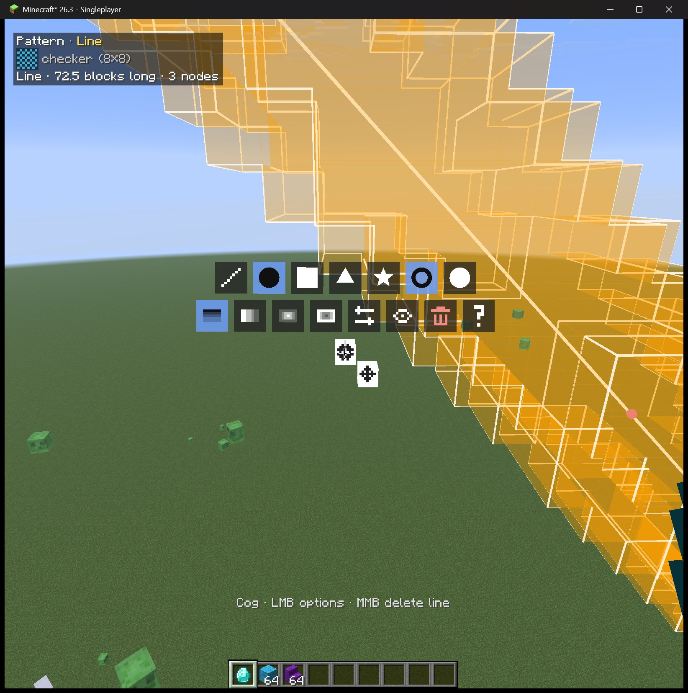

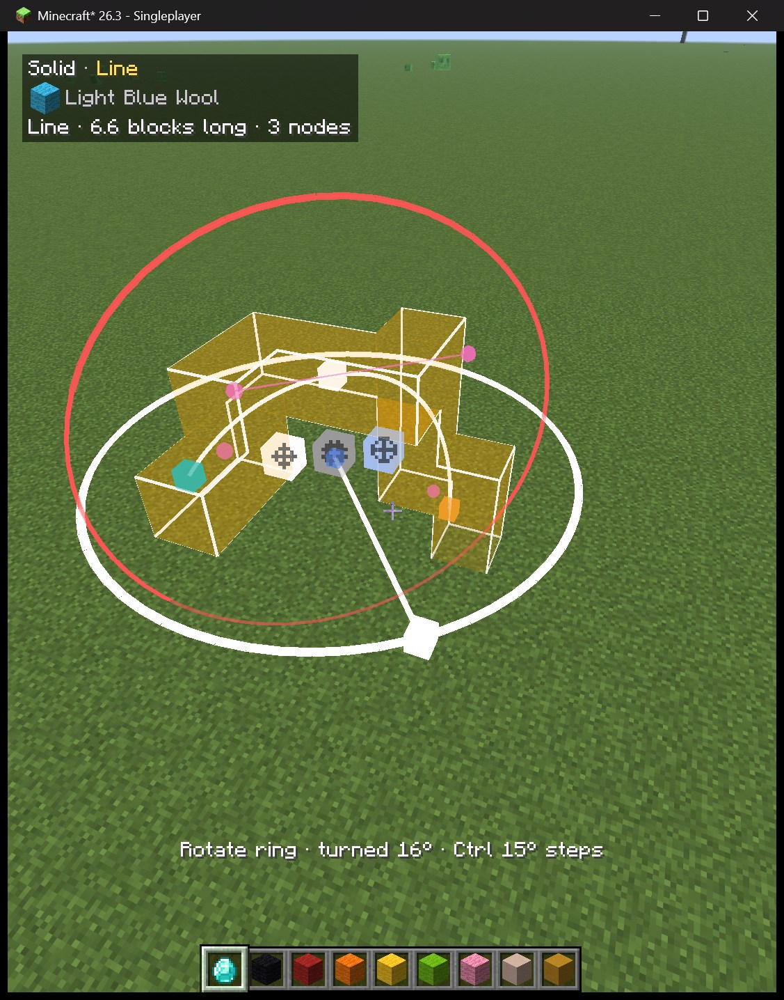

### Rendering: restyle a marker

The **eye** on a box, ring or line toolbar swaps the buttons for that marker's look (the arrow
goes back). The look is saved with the marker; **Reset** puts it back.

- **Colour** — filled squares colour the faces, hollow squares the edge lines; click the lit one
  again for the default.
- **Opacity** — the two framed − / + pairs set face and edge opacity in 10% steps.
- **Show as block** — pick any block from a filterable list and the marker is drawn with that
  block's textures (as full cubes). A preview only: nothing is placed.
- **Show when obscured** — whether faces and edge lines still show where real blocks are in
  front of them (edges do by default, faces don't).

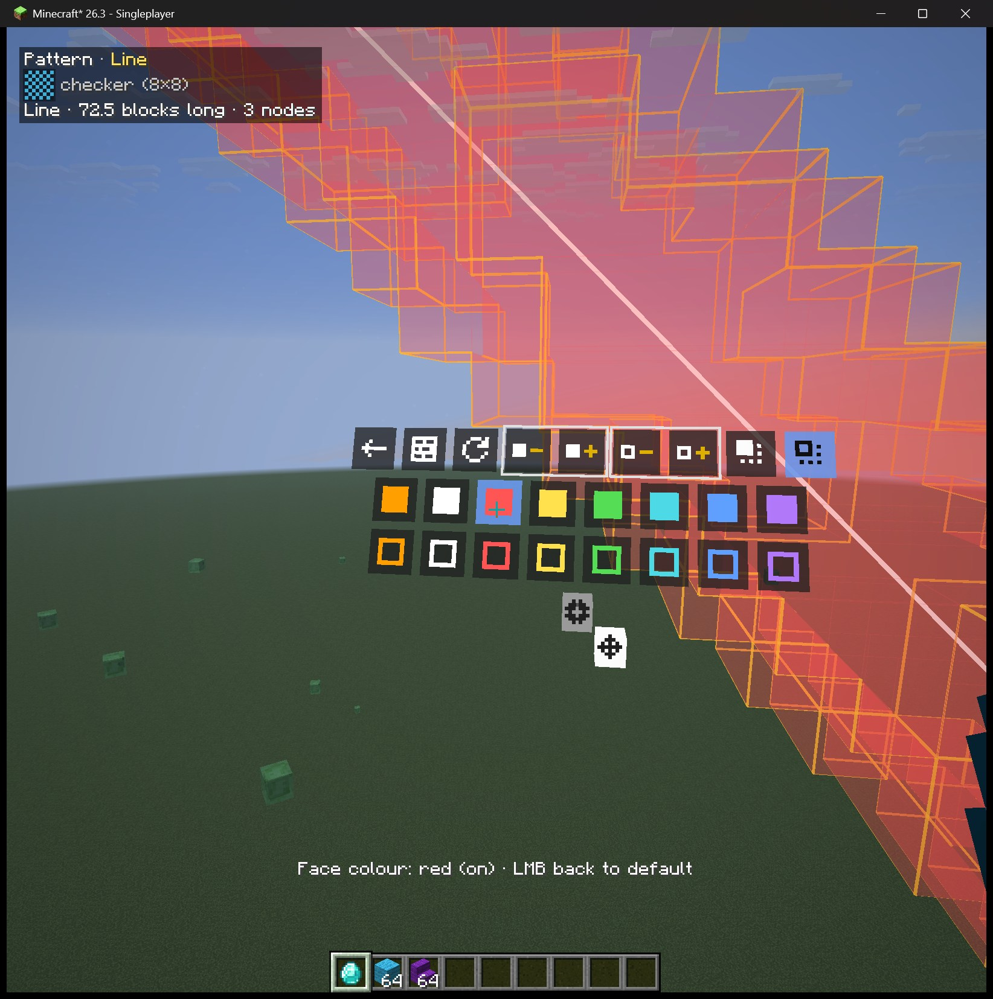

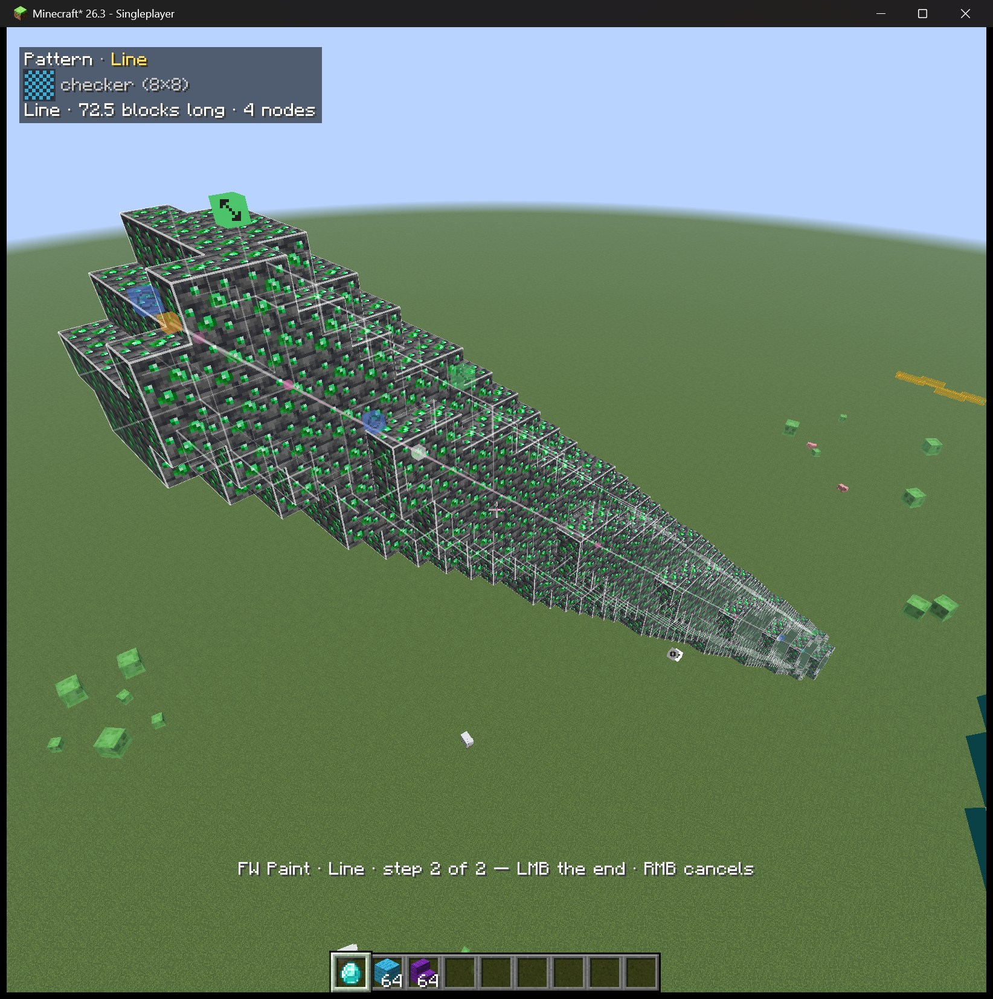

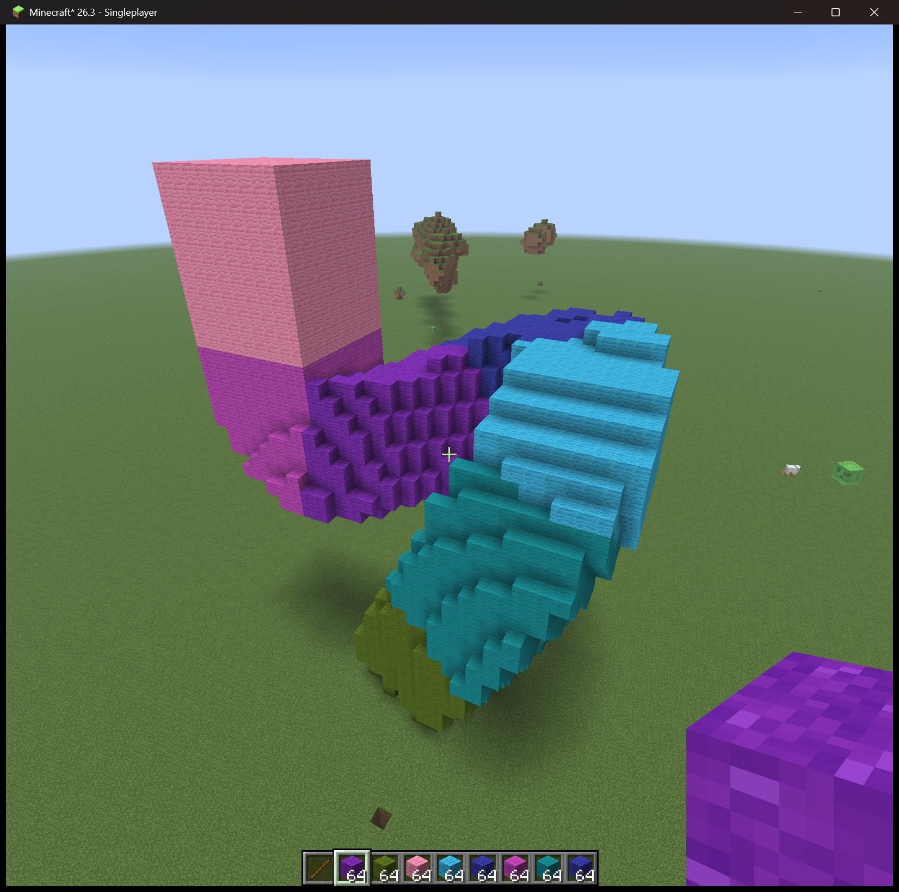

## Gradient painting

The palette in use, blended along your build — between markers or free-hand.

- **Between markers**: mark a start and end, click the face the line runs out of and hold — the
  palette stretches start→end, Auto segments anchoring to the real marker blocks.
- **Anywhere else**: the gradient grows out of the clicked face, sized by the palette's Sizing.
  **Paint memory** continues a half-finished gradient when re-clicked (cleared when you switch or
  edit palettes, or after the Settings idle timer); a *finished* gradient starts a fresh one on
  top.
- **3D gradients**: sphere-ish blends out from the clicked block; each fill remembers its centre.
  3D needs the strip to end in a real block (Auto at the start is fine).
- Honest ramps: running out of a palette block stops the paint with an "out of X" message — no
  silent substitutions.

## Noise painting

A seedable 3D noise field: valleys get the start of your palette's strip, peaks the end — with
the palette's noise type (Smooth / Perlin / Fractal), per-axis Scale, and Seed.

- **Region fill**: bound a region with start/end marker pairs, switch to 3D Fill, right-click an
  empty spot inside — the whole region floods at once. Or paint anywhere: Single / Face / 3D.
- The editor's noise preview shows it at real world coordinates starting at your feet — exactly
  what painting that spot would place. Drag the cube to move through the noise.

## Solid paint

One kind of block through any mode — pick **Solid** under Paint with. **Blocks from** (Hotbar /
Inventory / Both) fills the list; **left-click** a block to paint with it, **right-click** to
exclude it from matching (or include it again); the big preview shows what paints (or a **?**
when the mode decides at click time) and lists what's excluded. **Which block paints**: **This
block**, **Exact block** (copies the clicked block), **Closest colour / brightness** (nearest
match from your blocks, measured as the eye sees it — Oklab). **B** steps to the next block.

## Finder tab

Every placeable block in the game ranked by colour — discover blocks beyond your inventory.

- **Sort: Colour** — a rainbow (greys dark→light, then hue families) — or **Brightness**.
- Click a block to make it the **Reference** and centre it among its nearest colour neighbours,
  or pick a **Pure colour** in the hue/saturation field (+ brightness slider) — a coloured marker
  line shows where it falls. The target button re-centres after scrolling.
- Colours come from each block's actual textures — resource packs included.

## Settings

- **Paint tool** — click a row to make that item the tool (with a filter box; the current one is
  marked ● current).
- **General** — **Colour match** Perceptual (Oklab) or Classic; **When blocks are missing**:
  Don't paint or Skip them; **Paint memory** idle time — see above.
- **HUD** — **Move HUD…** repositions the HUD with a preview of your real HUD.
- **Keys & gestures** — every input as currently bound, with **Change in Controls…**.
- Mode options and marker settings (**Marker reach**, **Auto end marker**, **Clear all
  markers**) live on the **Place** tab.

## Requirements

- **Minecraft 26.3** · **Java 25** · pick your loader's file:
  - **Fabric** — Fabric Loader 0.19.5+ and **Fabric API** for 26.3
  - **NeoForge** — no other dependency
- Client-side only — nothing to install on the server.
- Placement sends normal "use block" interactions the server validates (Litematica-style); an
  aggressive anti-cheat may rate-limit very fast fills.

---

*Open source (MIT) — [github.com/nullabork/fw-paint-fabric](https://github.com/nullabork/fw-paint-fabric)*
